# HomeSentinel

App desktop per Linux e Windows che tiene d'occhio la casa tramite **Home Assistant**: quando un sensore si attiva compare in un angolo dello schermo una piccola finestra con la telecamera giusta. Se scatta l'antifurto appare una schermata a tutto schermo con tutte le telecamere, e quando suona il citofono un popup permette di aprire il cancello con un clic.

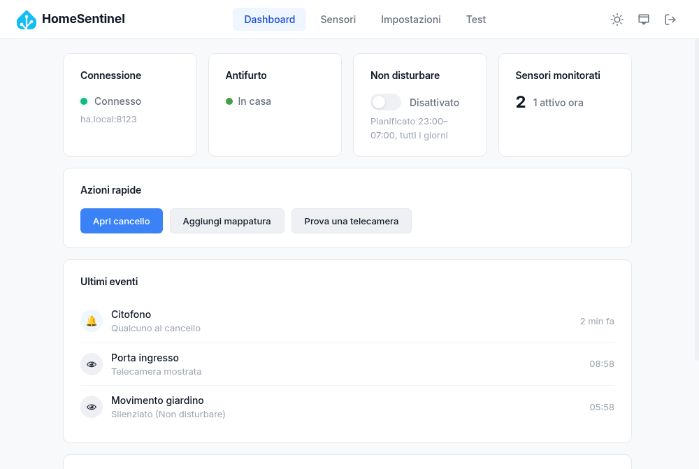

## Funzionalità

- **Finestre PiP automatiche**: associ un sensore (porta, movimento, ecc.) a una telecamera; quando il sensore si attiva la telecamera compare in una finestra sempre in primo piano e si chiude da sola dopo qualche secondo.
- **Allarme a tutto schermo**: quando l'antifurto passa a "In allarme" compare una schermata con tutte le telecamere, durata dell'allarme e pulsante di disattivazione (con PIN opzionale).
- **Citofono e cancello**: alla chiamata del citofono compare un popup con il video della telecamera di ingresso e il pulsante **Apri cancello**.
- **Non disturbare**: manuale (dashboard o tray) oppure pianificato per orari e giorni.
- **Ultimi eventi**: la dashboard mostra cosa è successo (sensori, citofono, cancello, allarme, disconnessioni), anche quando una finestra non è stata mostrata e perché.
- **MJPEG o HLS**: MJPEG quasi in tempo reale, oppure HLS con meno banda e audio; scelta globale o per singola telecamera.
- **Telecamere personalizzate**: anche telecamere fuori da Home Assistant, tramite URL diretto.
- **Connessione affidabile**: riconnessione automatica con backoff, rilevamento delle connessioni "morte", verifica al risveglio dalla sospensione.
- **Tema chiaro e scuro**, avvio automatico, icona nella tray.
- **Token protetto**: il token di Home Assistant è cifrato su disco con il portachiavi di sistema.

## Screenshot

| Dashboard (tema scuro) | Primo avvio |
| --- | --- |
| 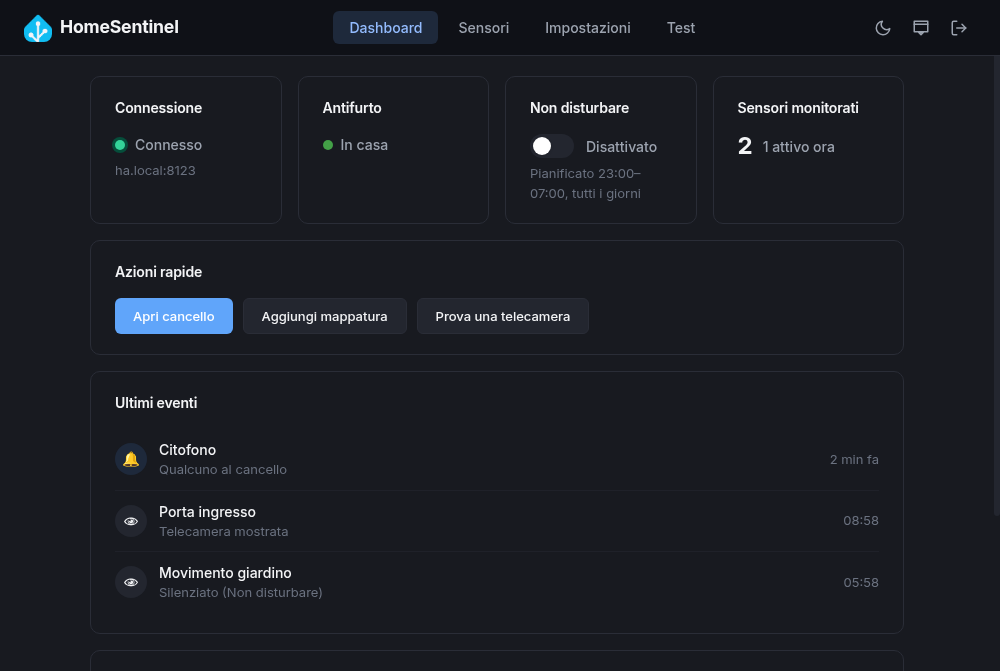 | 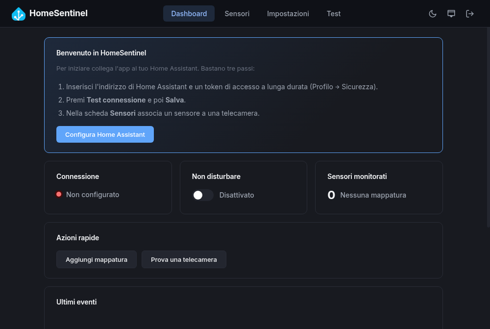 |

| Sensori e telecamere | Nuova mappatura |
| --- | --- |
| 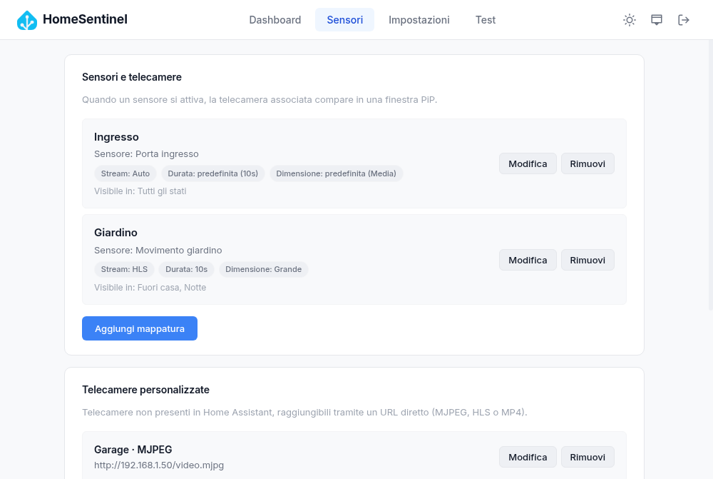 | 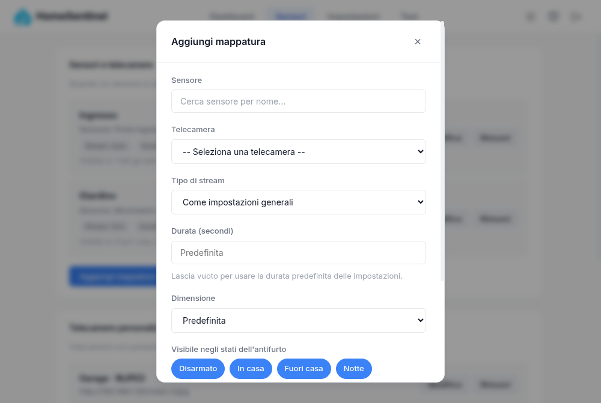 |

| Impostazioni: connessione | Impostazioni: finestre PiP |
| --- | --- |
| 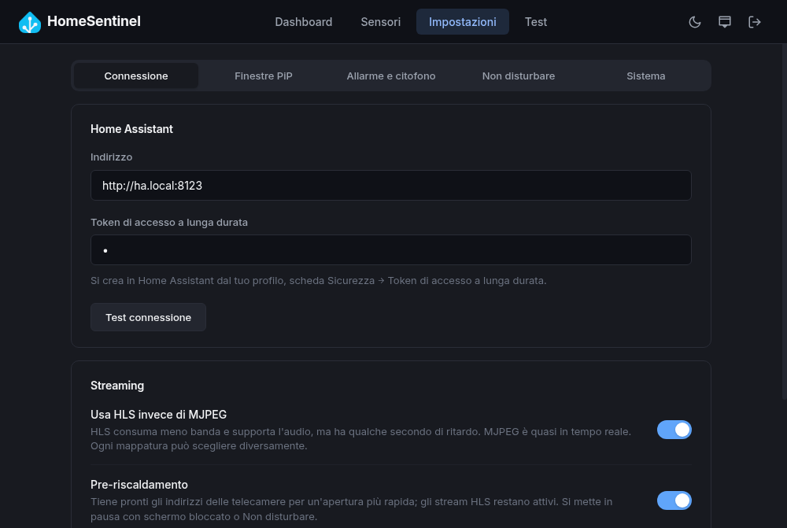 | 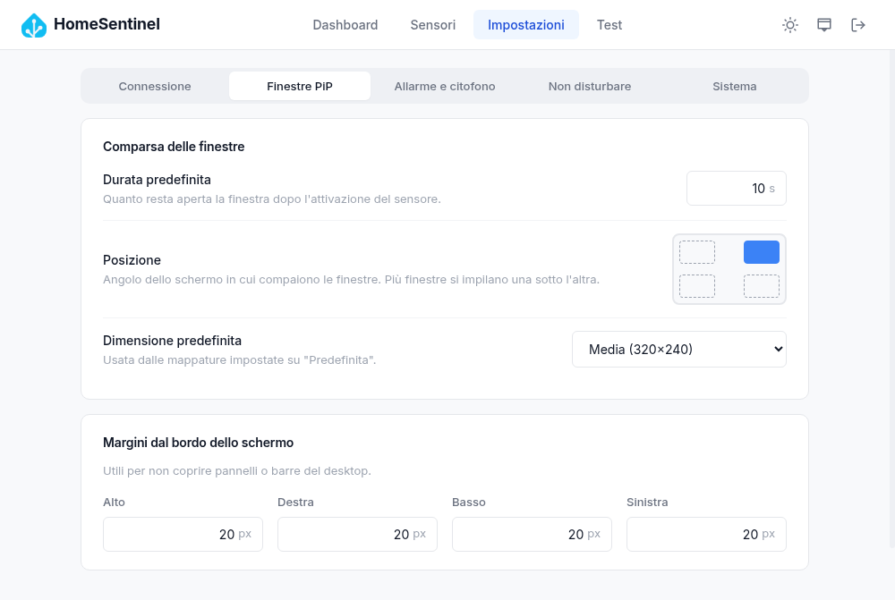 |

| Impostazioni: allarme e citofono | Impostazioni: Non disturbare |
| --- | --- |
| 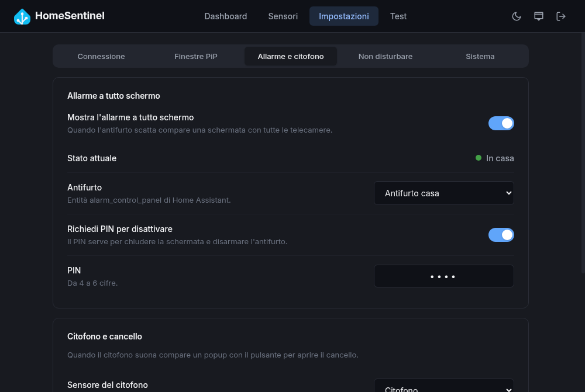 | 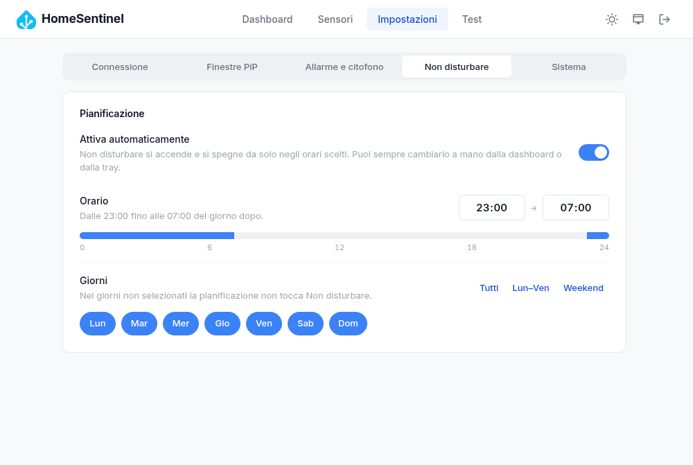 |

| Allarme a tutto schermo | Popup del citofono |
| --- | --- |
| 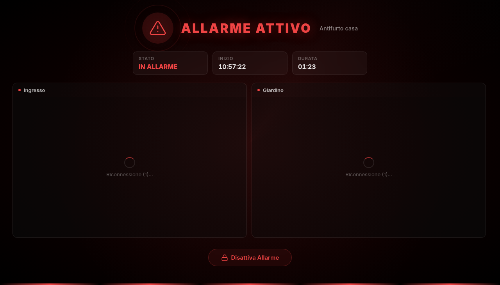 | 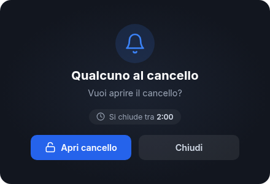 |

## Installazione

Scarica il pacchetto per il tuo sistema dalla pagina [Releases](https://git.devmin.it/carmine/homesentinel-app/releases):

| Sistema | Pacchetto | Installazione |
| --- | --- | --- |
| Debian, Ubuntu | file `.deb` | `sudo apt install ./HomeSentinel_x.y.z_amd64.deb` |
| Fedora, openSUSE | file `.rpm` | `sudo dnf install ./<file>.rpm` |
| Qualsiasi Linux | file `.AppImage` | `chmod +x homesentinel-*.AppImage` e avvialo |
| Windows | file `.exe` | Esegui l'installer |

Per aggiornare, dalla dashboard premi **Verifica aggiornamenti**: se c'è una nuova versione vedi le novità e il link per scaricarla.

## Primo avvio

1. **Crea un token** in Home Assistant: apri il tuo profilo, scheda **Sicurezza**, sezione **Token di accesso a lunga durata**, poi **Crea token** e copialo.
2. In HomeSentinel premi **Configura Home Assistant** (o vai in **Impostazioni → Connessione**), inserisci l'indirizzo (es. `https://homeassistant.local:8123`) e il token.
3. Premi **Test connessione**, poi **Salva impostazioni** nella barra in basso.
4. Vai in **Sensori → Aggiungi mappatura**, scegli un sensore e la telecamera da mostrare.
5. Dalla scheda **Test** puoi aprire subito una telecamera per controllare dimensione e posizione.

Da qui in poi l'app può stare chiusa nella tray: le finestre compaiono da sole.

## Come funziona

### Finestre PiP

Quando un sensore mappato passa da inattivo ad attivo (es. `off` → `on`, `closed` → `open`), la telecamera associata compare nell'angolo scelto. Se arrivano più eventi insieme, le finestre si impilano; se la stessa telecamera è già aperta, il suo timer riparte invece di aprirne un'altra.

Comandi della finestra (passa il mouse sopra per vederli):

| Comando | Funzione |
| --- | --- |
| Sposta | Tieni premuto e trascina per spostare la finestra |
| Espandi | Porta la telecamera a tutto schermo e ritorna |
| Blocca timer | Tiene aperta la finestra finché non la chiudi tu |
| Audio | Attiva l'audio (solo stream HLS) |
| Chiudi | Chiude subito la finestra |

La barra in basso indica il tempo rimanente.

Ogni mappatura può avere durata, dimensione e tipo di stream propri, oppure usare quelli predefiniti delle impostazioni. Se l'allarme è configurato puoi anche scegliere in quali stati dell'antifurto la telecamera deve comparire (per esempio solo quando sei fuori casa).

Le finestre **non** compaiono quando:
- è attivo Non disturbare;
- lo schermo è bloccato;
- è in corso un allarme (c'è già la schermata a tutto schermo);
- l'antifurto è in uno stato escluso per quella mappatura.

In tutti questi casi l'evento viene comunque registrato nella dashboard con il motivo.

### Allarme

In **Impostazioni → Allarme e citofono** attiva l'allarme a tutto schermo e scegli l'entità `alarm_control_panel`. Quando lo stato diventa *In allarme* (`triggered`):
- tutte le finestre PiP si chiudono e compare la schermata con le telecamere mappate;
- il pulsante **Disattiva allarme** disarma l'antifurto in Home Assistant (con il PIN, se l'hai richiesto);
- se l'allarme viene disarmato altrove, la schermata si chiude da sola.

Dalla scheda **Test** puoi vedere la schermata senza toccare l'antifurto.

### Citofono e cancello

Scegli il sensore del citofono (un `binary_sensor` o `input_boolean` che si attiva alla chiamata), l'entità `lock` del cancello e, se vuoi, la telecamera di ingresso. Quando il citofono suona compare il popup con il video; **Apri cancello** sblocca il lock. Il popup si chiude dopo due minuti o appena il cancello viene aperto, anche da un altro dispositivo. Senza entità lock ricevi solo una notifica.

Il cancello si può aprire anche dalla dashboard, con il pulsante **Apri cancello** tra le azioni rapide.

### Non disturbare

Si attiva dalla dashboard o dal menu della tray. In **Impostazioni → Non disturbare** puoi pianificarlo: scegli orario di inizio e fine (la timeline mostra la fascia, anche a cavallo della mezzanotte) e i giorni, con le scorciatoie *Tutti*, *Lun–Ven* e *Weekend*.

### Streaming e pre-riscaldamento

- **MJPEG** (predefinito): immagine quasi in tempo reale, consuma più banda.
- **HLS**: meno banda e audio, ma qualche secondo di ritardo. Se HLS non è disponibile per una telecamera, l'app passa da sola a MJPEG.

Il **pre-riscaldamento** tiene pronti gli indirizzi delle telecamere, così la finestra si apre senza attendere Home Assistant, e per l'HLS mantiene attivo lo stream. Si mette in pausa con lo schermo bloccato e con Non disturbare. Per avvii HLS ancora più rapidi attiva anche **Precarica flusso** nelle impostazioni della telecamera in Home Assistant.

### Impostazioni

Le impostazioni sono divise in sezioni (Connessione, Finestre PiP, Allarme e citofono, Non disturbare, Sistema). Le modifiche non vengono applicate finché non premi **Salva impostazioni**: una barra in basso ti ricorda le modifiche in sospeso e un pallino indica le sezioni modificate. Se esci dall'app con modifiche non salvate ti viene chiesta conferma.

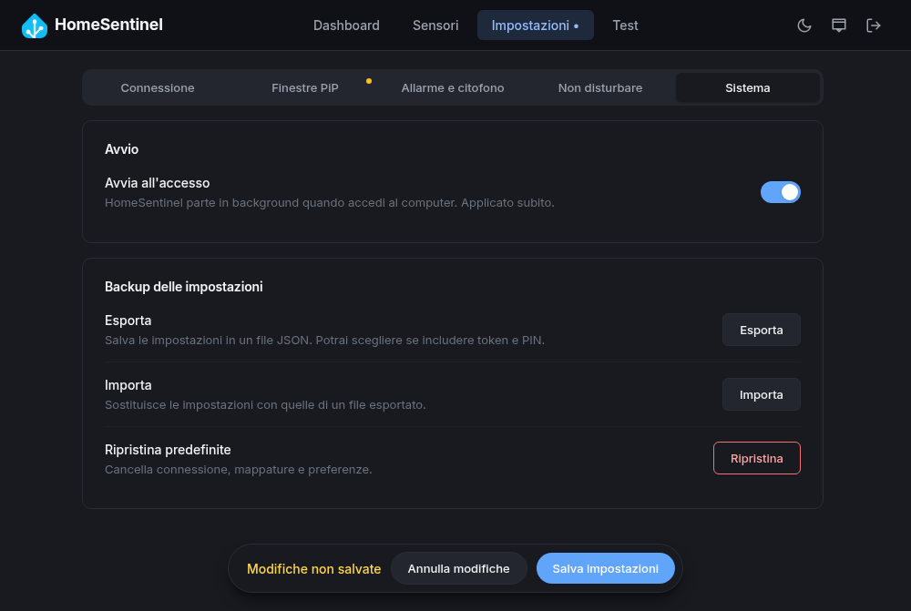

In **Sistema** trovi avvio automatico, esportazione, importazione e ripristino. All'esportazione puoi scegliere se includere token e PIN: il file è in chiaro, quindi di default vengono esclusi.

## Note per GNOME

- **Icona nella tray**: GNOME non mostra le icone di stato senza l'estensione [AppIndicator and KStatusNotifierItem Support](https://extensions.gnome.org/extension/615/appindicator-support/) (già inclusa in Ubuntu). Senza l'estensione l'app funziona lo stesso, ma una volta chiusa la finestra principale per riaprirla devi avviare di nuovo HomeSentinel dal menu delle applicazioni: verrà mostrata la finestra dell'istanza già in esecuzione.
- **Elenco "App in background"** (Impostazioni rapide di GNOME): GNOME mostra lì solo le app installate come **Flatpak**, perché l'elenco viene da xdg-desktop-portal e riguarda solo le app in sandbox. Con i pacchetti `.deb`, `.rpm` e AppImage HomeSentinel non può comparirci, qualunque sia la versione di Electron.

## Risoluzione dei problemi

| Problema | Cosa controllare |
| --- | --- |
| "Connessione in corso..." che non finisce | Indirizzo raggiungibile dal PC, token valido. **Test connessione** indica se il problema è l'indirizzo o il token. Con un token non valido l'app riprova ogni 5 minuti. |
| La finestra non compare | Non disturbare spento, schermo sbloccato, sensore mappato. Gli **Ultimi eventi** in dashboard dicono se l'evento è arrivato e perché la finestra non è stata mostrata. |
| Video nero o "Riconnessione..." | Apri la telecamera in Home Assistant per verificare che funzioni. Con HLS prova MJPEG per quella mappatura. |
| Il menu Antifurto, Citofono o Cancello mostra "(non trovato)" | L'entità salvata non esiste più in Home Assistant o è stata rinominata: selezionala di nuovo e salva. |
| Il token va reinserito dopo un cambio di sistema | Il token è cifrato con il portachiavi del sistema: su un altro computer (o dopo la reinstallazione) va inserito di nuovo. |

## Sviluppo

Requisiti: Node.js 22 o successivo.

```bash
git clone https://git.devmin.it/carmine/homesentinel-app.git
cd homesentinel-app
npm install
npm start
```

> Se avvii l'app dal terminale integrato di VS Code e ottieni l'errore `Cannot read properties of undefined (reading 'relaunch')`, la variabile `ELECTRON_RUN_AS_NODE` è impostata dall'editor: usa `env -u ELECTRON_RUN_AS_NODE npm start`.

### Struttura

```
main.js                       Processo principale: avvio, eventi, tray, risveglio dalla sospensione
index.html, renderer.js       Finestra principale (dashboard, sensori, impostazioni, test)
pip.html                      Finestra PiP della telecamera
alarm.html, alarm-renderer.js Schermata di allarme a tutto schermo
intercom.html, ...            Popup del citofono
src/main/
  websocket-manager.js        Connessione WebSocket a Home Assistant (heartbeat, backoff, richieste)
  pip-window-manager.js       Creazione e disposizione delle finestre PiP
  stream-prewarmer.js         Cache degli URL e keep-alive HLS
  alarm-window-manager.js     Schermata di allarme e disarmo
  intercom-window-manager.js  Popup del citofono
  dnd-scheduler.js            Pianificazione di Non disturbare
  event-log.js                Ultimi eventi mostrati in dashboard
  ipc-handlers.js             Comunicazione tra finestre e processo principale
  token-encryption.js         Cifratura del token con safeStorage
src/renderer/                 Gestione mappature e tema
src/shared/                   Impostazioni, configurazione, stati dell'antifurto
config/default-settings.js    Valori predefiniti
docs/screenshots/             Immagini di questo README
```

### Build

```bash
npm run build-linux   # AppImage, deb e rpm in dist/
npm run build-win     # installer NSIS per Windows
./build-linux.sh      # build Linux dentro Docker (electronuserland/builder)
```

Le release vengono create dalla pipeline Forgejo quando si pubblica un tag `v*`:

```bash
npm version minor     # oppure patch / major
git push --follow-tags
```

## Licenza

MIT
